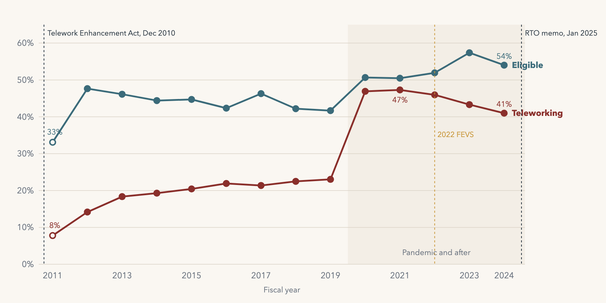
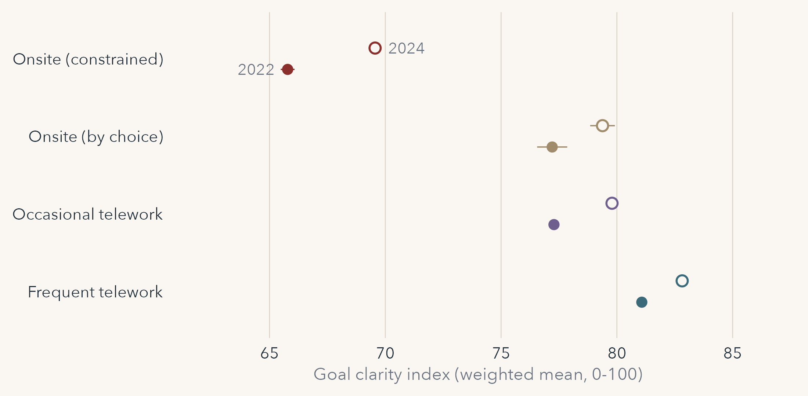
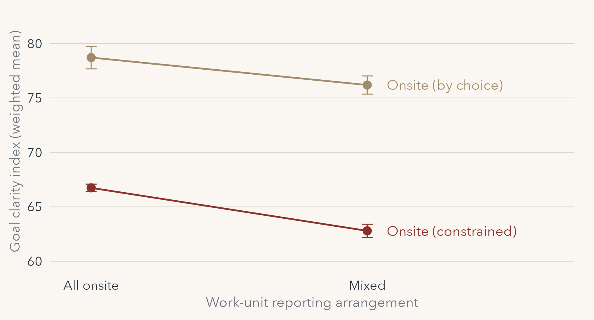

## Outline {.title-slide data-background-color="#102a43"}

::: hero-statement
- Workplace safety
- Work/life balance, and some of my own telework research
- After the break: The Blast in Centralia No. 5
:::

## Workplace Safety {.section-slide data-background-color="#102a43"}

## State and Local Jobs Are Riskier Than Private Ones

::: {.stat-row .ws-big}
<div class="stat ws-accent"><span class="stat-number">4.4</span><p>state and local government</p></div>
<div class="stat"><span class="stat-number">2.3</span><p>private industry</p></div>
:::

::: lead-in
Nonfatal injuries and illnesses per 100 full-time workers, 2024
:::

::: {.question-bar .fragment}
Why would a government job be nearly twice as likely to hurt you?
:::

::: source-line
U.S. Bureau of Labor Statistics, Employer-Reported Workplace Injuries and Illnesses, 2024 (national rates as reported in BLS regional releases, Feb. 2026).
:::

## Who Protects You Depends on Who You Work For

::::::: {.system-cols .lr-regimes .ws-big}
::: system-col
[Private and nonprofit]{.card-heading}

<p>Federal OSHA sets the standards, inspects, and can fine</p>
:::

::: system-col
[Federal]{.card-heading}

<p>Each agency runs its own program. OSHA inspects but can't fine</p>
:::

::: {.system-col .lr-idaho}
[Idaho state and local]{.card-heading}

<p>Federal OSHA doesn't cover them, and Idaho has no OSHA-approved State Plan</p>
:::
:::::::

::: source-line
Occupational Safety and Health Act of 1970; Exec. Order No. 12196; OSHA, State Plans.
:::

## Safety Starts with a Risk Assessment

:::::::::: {.pathway .lr-path .ws-big}
::: pathway-step
[Find the risks]{.card-heading}

<p>Health, safety, information security, legal</p>
:::

::: pathway-arrow
→
:::

::: pathway-step
[Make a plan]{.card-heading}

<p>What to prevent, and what to do if it happens</p>
:::

::: pathway-arrow
→
:::

::: pathway-step
[Name an owner]{.card-heading}

<p>A risk manager runs it across departments</p>
:::

::: pathway-arrow
→
:::

::: {.pathway-step .accent-step}
[Keep it current]{.card-heading}

<p>Audits, updated policies, lessons from incidents</p>
:::
::::::::::

## Bullying, Harassment, and Violence Are Different Problems

::::::: {.system-cols .lr-regimes .ws-big}
::: system-col
[Bullying]{.card-heading}

<p>Repeated, intentional misuse of power to humiliate or undermine someone</p>
:::

::: system-col
[Harassment]{.card-heading}

<p>Unwelcome conduct based on a protected trait, which the law covers. See last week</p>
:::

::: system-col
[Violence]{.card-heading}

<p>An act or threat at work, from verbal abuse to physical assault</p>
:::
:::::::

::: {.question-bar .fragment}
You see it happen to a coworker. What's your role?
:::

## Preventing Violence Takes More Than a Policy

::::::: {.system-grid .roomy-grid .lr-justice .ws-six}
::: system-item
[A clear policy]{.card-heading}

<p>Prevention, response, care for victims</p>
:::

::: system-item
[Training]{.card-heading}

<p>Especially for supervisors</p>
:::

::: system-item
[Threat assessment team]{.card-heading}

<p>HR, security, legal, EAP, the union</p>
:::

::: system-item
[Crucial conversations]{.card-heading}

<p>Deal with conflict before it escalates</p>
:::

::: system-item
[See something, say something]{.card-heading}

<p>Minor incidents get reported too</p>
:::

::: {.system-item .ws-accent}
[Trust]{.card-heading}

<p>People believe a report will be acted on</p>
:::
:::::::

## Virginia Beach, May 31, 2019

:::::::::: {.pathway .lr-path .ws-big}
::: pathway-step
[What happened]{.card-heading}

<p>A city employee killed 12 people at the municipal center</p>
:::

::: pathway-arrow
→
:::

::: pathway-step
[The response]{.card-heading}

<p>Counseling, and supervising the people who were there</p>
:::

::: pathway-arrow
→
:::

::: {.pathway-step .accent-step}
[After-action report]{.card-heading}

<p>Independent review: 58 recommendations</p>
:::
::::::::::

::: {.takeaway .fragment}
27 of the 58 recommendations concerned human resources.
:::

::: source-line
Hillard Heintze, independent review for the City of Virginia Beach (Nov. 2019), as reported by Route Fifty.
:::

## Activity: Find It {.activity-slide .ws-roomy data-background-color="#176b87"}

::: activity-prompt
Boise State is your employer. Use your phones.
:::

::: jd-questions
1.  Is there a workplace violence policy? When was it last updated?
2.  Where would you report a threat?
3.  What training is offered?
:::

::: activity-close
6 minutes in groups, then tell us how hard it was to find
:::

## Work/Life Balance {.section-slide data-background-color="#102a43"}

## Work/Life Conflict Is About Scarce Resources

::: lead-in
People protect their time, energy, and attention. Conflict is what happens when one role drains what another needs.
:::

::::::: {.system-grid .roomy-grid .lr-justice .ws-four}
::: system-item
[Work → family]{.card-heading}
:::

::: system-item
[Family → work]{.card-heading}
:::

::: system-item
[Role overload]{.card-heading}
:::

::: system-item
[Caregiver strain]{.card-heading}
:::
:::::::

::: {.question-bar .fragment}
Isn't this the employee's problem? Why should the employer care?
:::

## More Than Family-Friendly

::::::: {.system-grid .roomy-grid .lr-justice .ws-eight}
::: system-item
[Education]{.card-heading}

<p>Tuition help</p>
:::

::: system-item
[Family]{.card-heading}

<p>Child and elder care</p>
:::

::: system-item
[Flextime, flexplace]{.card-heading}

<p>Schedules, telework</p>
:::

::: system-item
[Insurance]{.card-heading}

<p>Health, life</p>
:::

::: system-item
[Wellness]{.card-heading}

<p>Fitness, stress</p>
:::

::: system-item
[Leave]{.card-heading}

<p>Parental, volunteer</p>
:::

::: system-item
[Transit]{.card-heading}

<p>Passes, parking</p>
:::

::: system-item
[EAP]{.card-heading}

<p>Confidential counseling</p>
:::
:::::::

::: {.question-bar .fragment}
Which would you look for first? Would your answer change in five years?
:::

## Federal Telework Grew, Then a Memo Ordered It Back {data-background-color="#faf7f2"}

::: ws-fig
{fig-alt="Line chart, fiscal years 2011 to 2024. The share of federal employees eligible to telework rises from 33 to 54 percent. The share teleworking rises from 8 percent to 47 percent in 2021 and eases to 41 percent in 2024."}
:::

::: source-line
Share of all employees, from OPM's *Status of Telework* reports; matched-agency weighted rates, not official totals. Return to In-Person Work memorandum, Jan. 20, 2025.
:::

## Telework Works for the Teleworker. What About the Rest?

::::::: {.system-cols .lr-regimes .ws-big}
::: system-col
[What we know]{.card-heading}

<p>Teleworkers tend to be more satisfied. A randomized trial found no loss in performance ratings</p>
:::

::: system-col
[What's missing]{.card-heading}

<p>Most studies measure the person who went remote, not the coworkers still in the office</p>
:::

::: {.system-col .lr-idaho}
[Why government is different]{.card-heading}

<p>Public goals are vague by design. Managers and coworkers fill them in, every day, in the work unit</p>
:::
:::::::

::: source-line
Gajendran and Harrison (2007); Bloom, Han, and Liang (2024); Chun and Rainey (2005); Pandey and Wright (2006); Fowler and Birdsall (2025).
:::

## My Research: What Happens to the People Who Stay?

::: ws-question
Do onsite employees in hybrid units report less goal clarity than onsite employees in fully onsite units?
:::

::::::: {.system-cols .lr-regimes .ws-small}
::: system-col
[The data]{.card-heading}

<p>2022 Federal Employee Viewpoint Survey: 438,928 employees</p>
:::

::: system-col
[The key question]{.card-heading}

<p>"How do employees in your work unit report to work?"</p>
:::

::: system-col
[Goal clarity]{.card-heading}

<p>Know the unit's goals, understand priorities, managers communicate them. 0–100</p>
:::
:::::::

::: source-line
Birdsall and Fowler, working paper.
:::

## Frequent Teleworkers Report the Clearest Goals {data-background-color="#faf7f2"}

::: ws-fig
{fig-alt="Dot plot of the goal clarity index by telework arrangement. Onsite because constrained is lowest, near 66 in 2022 and 70 in 2024. Onsite by choice and occasional telework are near 77 to 80. Frequent telework is highest, near 81 to 83."}
:::

::: source-line
Constrained: onsite because the job, technology, or a denied request requires it. Weighted means; filled = 2022 (N = 438,928), hollow = 2024 (N = 513,962). Birdsall and Fowler, working paper.
:::

## In Hybrid Units, the People Onsite Report Less Clarity {data-background-color="#faf7f2"}

::: {.ws-fig .ws-fig-short}
{fig-alt="Line chart of goal clarity among onsite employees. Moving from an all-onsite unit to a mixed unit, onsite by choice employees fall from about 79 to 76, and constrained onsite employees fall from about 67 to 63."}
:::

::: {.takeaway .fragment}
About 4 points lower with controls, and 11 percentage points more likely to say telework options have them considering leaving.
:::

::: {.question-bar .fragment}
You manage a hybrid unit. What do you do for the people who have to come in?
:::

::: source-line
Weighted means with 95% CIs, 2022 FEVS. An association, measured before the 2025 return-to-office order. Birdsall and Fowler, working paper.
:::

## Parental Leave Depends on Who You Work For

::: {.stat-row .ws-four-stats}
<div class="stat"><span class="stat-number">12 weeks</span><p>unpaid under FMLA, if you qualify</p></div>
<div class="stat"><span class="stat-number">12 weeks</span><p>paid, federal employees</p></div>
<div class="stat"><span class="stat-number">8 weeks</span><p>paid, Idaho executive branch, by executive order</p></div>
<div class="stat ws-accent fragment"><span class="stat-number">2 weeks</span><p>paid, Idaho Attorney General's office, from July 1, 2026</p></div>
:::

::: {.question-bar .fragment}
It's a policy, not a law. What happens to morale when a benefit is taken back?
:::

::: source-line
29 U.S.C. § 2612; OPM, Paid Parental Leave; Idaho Exec. Order No. 2020-03 and DHR Statewide Policy § 10; *Idaho Statesman* (Jan. 8, 2026).
:::

## Activity: One Benefit, Tight Budget {.activity-slide .ws-roomy data-background-color="#176b87"}

::: activity-prompt
Your budget funds one new benefit. Each group gets one workforce.
:::

```{=html}
<div class="pm-stay lr-stay">
<div class="pm-stay-card"><span class="pm-stay-tag">Group 1</span><p>911 dispatchers at Ada County, on 24-hour shifts</p></div>
<div class="pm-stay-card"><span class="pm-stay-tag">Group 2</span><p>Analysts at an Idaho state agency</p></div>
<div class="pm-stay-card"><span class="pm-stay-tag">Group 3</span><p>Caseworkers at a Boise nonprofit</p></div>
</div>
```

::: jd-questions
1.  Which benefit do you fund?
2.  Who gets nothing from it?
:::

::: activity-close
8 minutes in groups, then each group reports
:::

## Case Study: The Blast in Centralia No. 5 {.section-slide data-background-color="#102a43"}

## "Please Save Our Lives"

::: ws-quote
"…Governor Green this is a plea to you, to please save our lives…"
:::

::: ws-attrib
Local Union No. 52 to the Governor of Illinois, received March 9, 1946
:::

::: {.stat-row .fragment .ws-one-stat}
<div class="stat ws-accent"><span class="stat-number">111</span><p>men killed at Centralia No. 5, March 25, 1947</p></div>
:::

::: {.takeaway .fragment}
A safe workplace is one where the warning reaches someone who will act.
:::

::: source-line
John Bartlow Martin, "The Blast in Centralia No. 5," *Harper's Magazine*, March 1948.
:::

## Next Week…

**November 16: HR reforms and looking forward**

Guy & Sowa, Chapters 14 and 15

**Case:** Cutting the Civil Service: The 2025 Federal Workforce Reductions
